# GearLoop: campus gear lending, shipped the DevSecOps way

**Session 21 DevSecOps capstone** · Netram Faran (`netram75`) · enrollment 24BCS10329

GearLoop is the lending desk for a campus media lab, robotics lab and XR studio. Students
reserve cameras, drones, audio kits, lab kits, laptops and VR headsets. Staff check items
out, take them back and chase what is overdue. The application is small on purpose. The
point of the project is everything around it: tests, containers, a gated CI/CD pipeline
with image scanning, infrastructure as code, Kubernetes with Helm, GitOps with Argo CD,
and Prometheus/Grafana observability.

| | |
|---|---|
| **Demo video** | [demo/GearLoop-demo.mp4](demo/GearLoop-demo.mp4) |
| **Slides** | [demo/GearLoop-presentation.pptx](demo/GearLoop-presentation.pptx) · [PDF](demo/GearLoop-presentation.pdf) |
| **Pipeline** | [GitHub Actions runs](https://github.com/netram75/devsecops-python/actions) |
| **Images** | [ghcr.io/netram75/gearloop-backend](https://github.com/netram75/devsecops-python/pkgs/container/gearloop-backend) · [gearloop-frontend](https://github.com/netram75/devsecops-python/pkgs/container/gearloop-frontend) |

| Layer | What is used |
|---|---|
| Frontend | React 19 + Vite 8, served by unprivileged nginx (UID 101) |
| Backend | FastAPI, SQLAlchemy 2, Alembic, Python 3.12 (UID 10001) |
| Database | PostgreSQL 17 (CHECK constraints, advisory-locked migrations) |
| Tests | pytest, 32 tests, 92% coverage, throwaway SQLite built by the real migrations |
| CI/CD | GitHub Actions, 9 jobs, images in GHCR tagged with the commit SHA |
| Security | Trivy (images), Gitleaks (full history), Bandit (SAST), npm audit, Pod Security "restricted" |
| Kubernetes | kind (1 control plane + 2 workers), Helm chart, ingress-nginx, HPA, PDBs |
| GitOps | Argo CD 3.5, automated sync with prune + self-heal |
| Observability | kube-prometheus-stack: Prometheus, Grafana, Alertmanager, business metrics + alerts |
| Infrastructure | Terraform: VPC with 2 public + 2 private subnets, NAT, EKS 1.35 + managed node group |

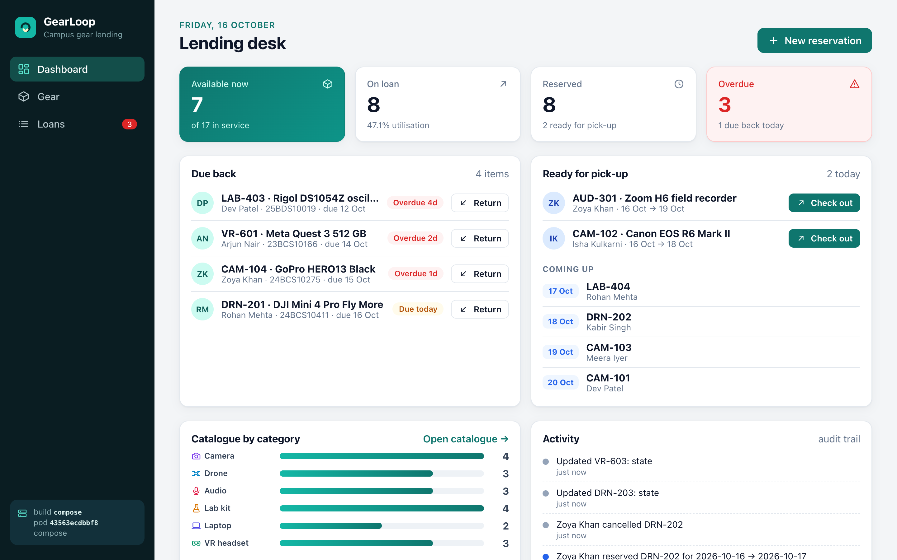

## Contents

1. [What the app does](#what-the-app-does)
2. [Architecture](#architecture)
3. [Tech stack](#tech-stack)
4. [Repository structure](#repository-structure)
5. [Run it locally](#run-it-locally)
6. [M1 Application](#m1-application) · [M2 Testing](#m2-testing) · [M3 Git](#m3-git-and-github) · [M4 Docker](#m4-docker)
7. [M5 CI/CD](#m5-cicd) · [M6 DevSecOps](#m6-devsecops) · [M7 Terraform](#m7-terraform)
8. [M8 Kubernetes + Helm + Argo CD](#m8-kubernetes--helm--argo-cd) · [M9 Observability](#m9-observability)
9. [Troubleshooting labs](#troubleshooting-labs)
10. [Engineering findings](#engineering-findings)
11. [Known issues and limitations](#known-issues-and-limitations)
12. [M10 Presentation](#m10-presentation) · [Submission checklist](#submission-checklist)

## What the app does

GearLoop keeps a catalogue of items, each with a tag such as `CAM-101`, and a loan for each
time an item is borrowed. Every change is written to an audit table, which the UI shows as
the activity feed.

**Lending rules (enforced in the API, backed by the database):**

| Rule | Response | How it holds under concurrency |
|---|---|---|
| An item cannot be lent twice for overlapping dates. A checked-out item blocks the asset until it is actually returned, even when overdue | `409 asset_unavailable` | the asset row is locked (`SELECT … FOR UPDATE`) before the overlap check, so two backend replicas cannot both win |
| At most 3 active loans per student | `409 borrower_limit` | per-borrower `pg_advisory_xact_lock` (locks are taken borrower → asset, so they cannot deadlock) |
| Loan length is capped per category (drone 3 days … lab kit 14 days) | `422 loan_too_long` | rule published through `/api/info`; the UI reads it instead of hardcoding it |
| Reservations start today or later, at most 30 days ahead | `422` | |
| State machine `reserved → checked_out → returned`, `reserved → cancelled`. Anything else | `409 illegal_transition` | the asset row lock serialises transitions |
| Items in maintenance or retired cannot be reserved | `409` | |
| Lending history is kept: only reservations can be edited or deleted; an asset with history must be retired, not deleted | `409` | `CHECK` constraints and `FOREIGN KEY … ON DELETE RESTRICT` in the migration |

**Endpoints** (OpenAPI at `/docs`):

| Method | Path | Purpose |
|---|---|---|
| GET | `/health` | liveness, never touches the DB |
| GET | `/ready` | readiness: DB reachable **and** migrated, else `503` |
| GET | `/metrics` | Prometheus metrics (HTTP + business gauges) |
| GET | `/api/info` | build version, pod name, campus date, lending rules |
| GET | `/api/stats` · `/api/activity` | dashboard numbers, audit feed |
| GET/POST | `/api/assets` | list (filter by category/state/search/availability), create |
| GET/PUT/DELETE | `/api/assets/{id}` | read, update, delete |
| GET | `/api/assets/{id}/loans` | an item's loan history |
| GET/POST | `/api/loans` | list (status/overdue/borrower/view filters), reserve |
| GET/PUT/DELETE | `/api/loans/{id}` | read, change dates, delete a reservation |
| POST | `/api/loans/{id}/checkout` · `/return` · `/cancel` | state transitions |

## Architecture

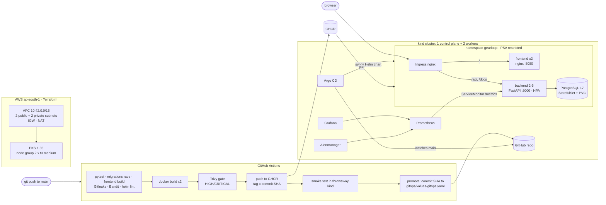

Request path: browser → ingress-nginx → `/` to the frontend Service, `/api` to the backend
Service → PostgreSQL. With `docker compose` the frontend nginx does the same routing, so the
browser only ever calls relative `/api/...` URLs.

## Tech stack

| Area | Tool | Version |
|---|---|---|
| Language/runtime | Python · Node | 3.12 · 22 |
| Backend | FastAPI · SQLAlchemy · Alembic · psycopg · pydantic | 0.143 · 2.1 · 1.20 · 3.3 · 2.14 |
| Frontend | React · Vite | 19.3 · 8.3 |
| Images | `python:3.12-slim` (multi-stage) · `node:22-alpine` → `nginxinc/nginx-unprivileged:1.31-alpine` · `postgres:17-alpine` | |
| Tests | pytest · pytest-cov · httpx2 | 9.1 · 7.1 · 2.13 |
| Security | Trivy · Gitleaks · Bandit | 0.75 · 8.30 · 1.9 |
| Kubernetes | kind · kubectl · Helm · ingress-nginx · metrics-server | 0.33 (k8s 1.37) · 1.36 · 4.3 · 1.15.1 |
| GitOps | Argo CD (argo-cd chart 10.10.5) | 3.5.5 |
| Observability | kube-prometheus-stack chart | 92.8.0 |
| IaC | Terraform · AWS provider · moto | 1.16.6 · 6.69.1 · 5.1.22 |

## Repository structure

```text
.
├── backend/                 FastAPI app, Alembic migrations, tests, Dockerfile (multi-stage)
│   ├── app/                 config, db, models, schemas, services (rules), metrics, main (routes)
│   ├── alembic/versions/    0001 assets + loans (CHECK constraints) · 0002 events (audit)
│   └── tests/               32 pytest cases (conftest builds a SQLite DB via the real migrations)
├── frontend/                React + Vite app, nginx template, Dockerfile (Node build → nginx)
├── docker-compose.yml       postgres → backend → frontend, health-gated
├── .github/workflows/       ci-cd.yml (9 jobs)
├── security/                trivy.yaml · .gitleaks.toml · bandit.yaml
├── helm/gearloop/           chart: templates, values-{dev,staging,prod}.yaml, Grafana dashboard
├── k8s/                     namespace.yaml (PSA restricted) · kind/ (cluster + bootstrap.sh) · jobs/
├── gitops/                  Argo CD install values, Application, values-gitops.yaml (CI writes the SHA)
├── monitoring/              kube-prometheus-stack values
├── terraform/               VPC + EKS (plain resources) · emulator/ (moto runner)
├── scripts/                 seed.py · age-demo-data.sql · load-test.sh · migration-race.sh
├── troubleshooting/         three broken Deployments + fixes
├── screenshots/             evidence used below
├── demo/                    video + slides
└── docs/COURSE-README.md    the original course README (TaskBoard reference)
```

## Run it locally

```bash
git clone https://github.com/netram75/devsecops-python.git && cd devsecops-python
cp .env.example .env                      # optional: change the local DB password
docker compose up --build                 # postgres -> backend (migrates) -> frontend
open http://localhost:3000                # API docs: http://localhost:3000/docs
API=http://localhost:3000 python3 scripts/seed.py      # realistic catalogue + loans
docker compose exec -T postgres psql -U gearloop -d gearloop < scripts/age-demo-data.sql  # history + overdue
```

Backend tests without Docker:

```bash
cd backend && uv venv -p 3.12 .venv && uv pip install -p .venv/bin/python -r requirements-dev.txt
.venv/bin/python -m pytest -v --cov=app
```

The full Kubernetes platform (kind + ingress + monitoring + Argo CD) is one script:
`k8s/kind/bootstrap.sh`. Then add
`127.0.0.1 gearloop.local staging.gearloop.local argocd.gearloop.local grafana.gearloop.local prometheus.gearloop.local`
to `/etc/hosts`.

---

## M1 Application

- FastAPI backend with `/health`, `/ready`, `/metrics` and 15 REST operations covering GET, POST, PUT and DELETE (table above).
- PostgreSQL with three tables managed by two Alembic migrations ([0001](backend/alembic/versions/0001_create_assets_and_loans.py), [0002](backend/alembic/versions/0002_create_events.py)). `alembic.ini` sets `prepend_sys_path = .` so the `alembic` script can import `app` inside the container.
- React UI: dashboard, catalogue, loans. Loading and backend-down states. A 14-day availability strip warns about a clash before the API refuses it. Under 760 px the sidebar turns into a top bar and table rows become cards.

| Dashboard | Catalogue |
|---|---|
|  | 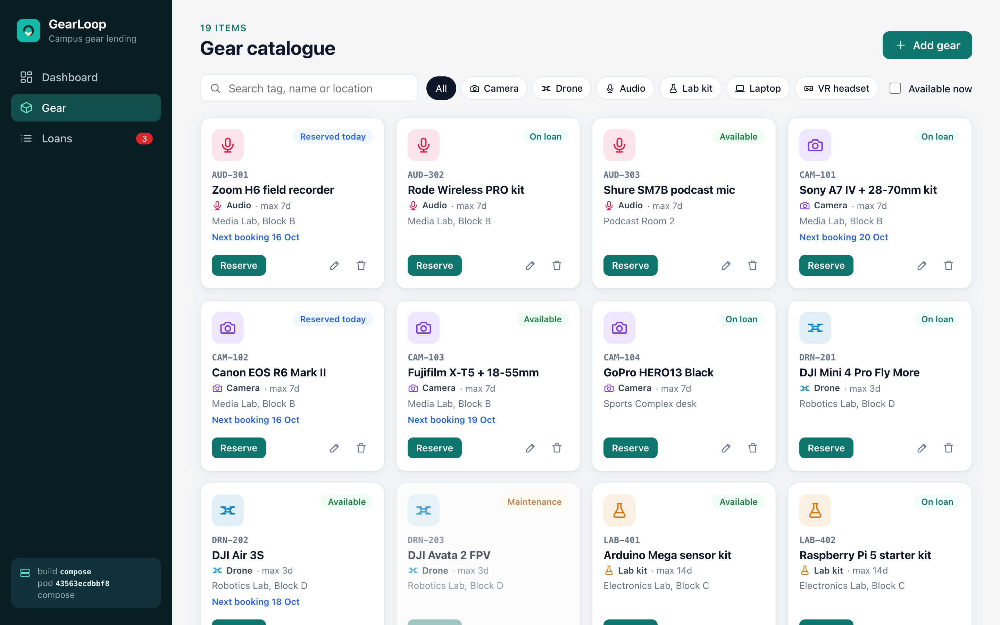 |
| **Loans** | **Reservation refused with the API's 409** |
| 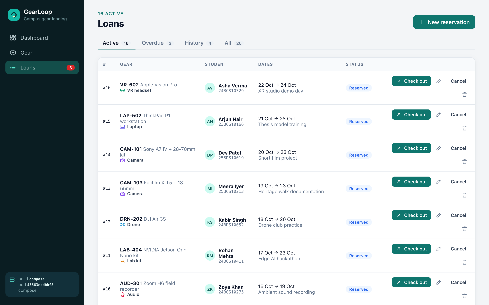 | 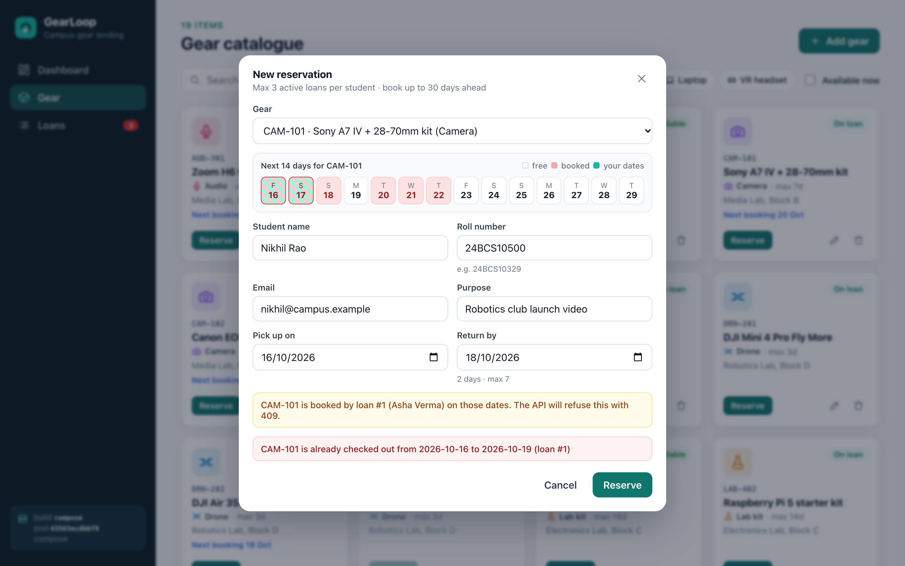 |
| **Phone width (390 px)** | **Swagger `/docs`** |
| 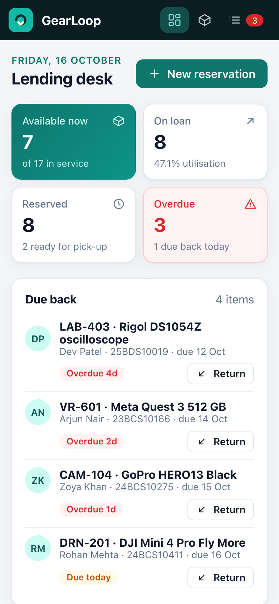 | 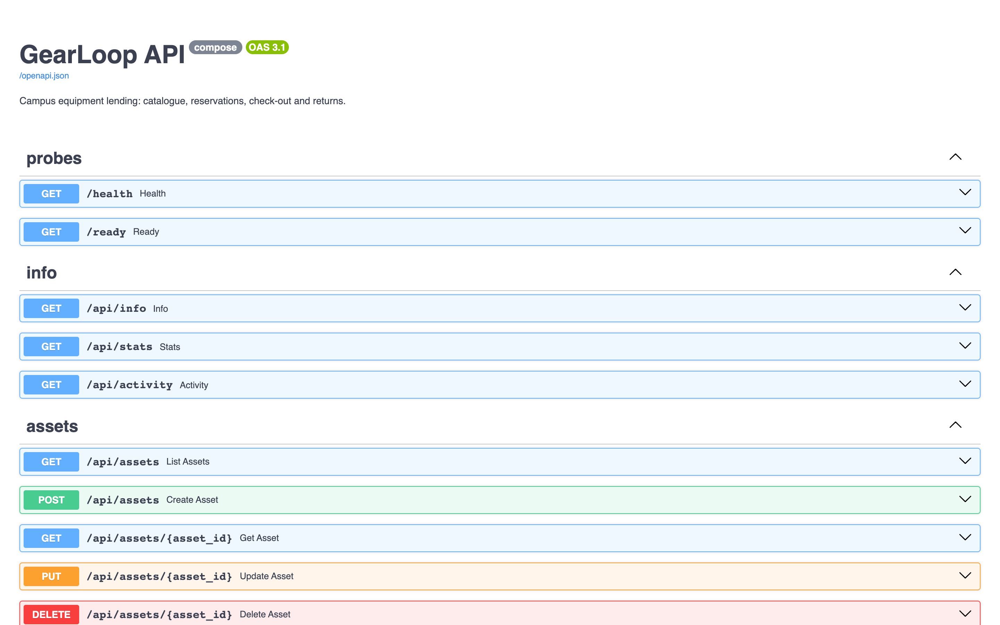 |

## M2 Testing

- [`backend/pytest.ini`](backend/pytest.ini) and [`backend/tests/conftest.py`](backend/tests/conftest.py). `conftest.py` sets `DATABASE_URL` to a temporary **SQLite** file *before* the app is imported, then builds the schema by running the **real Alembic migrations**. The tests never touch Postgres, and every run also tests the migrations.
- Each test starts from empty tables. A `shift_today` fixture moves the campus clock to test overdue and late-return cases.
- **32 tests across 3 files and 12 endpoints**: CRUD happy paths, 404s, 409 conflicts (overlap, borrower limit, illegal transitions, locked loans, assets with history), 422 validation, every state transition, stats, the audit feed, `/metrics` content, and a CHECK constraint refusing an impossible row even when the API is bypassed.
- Coverage: **92%** of `app/`.
- In CI the same suite runs first; a single failure stops the pipeline before any image is built.

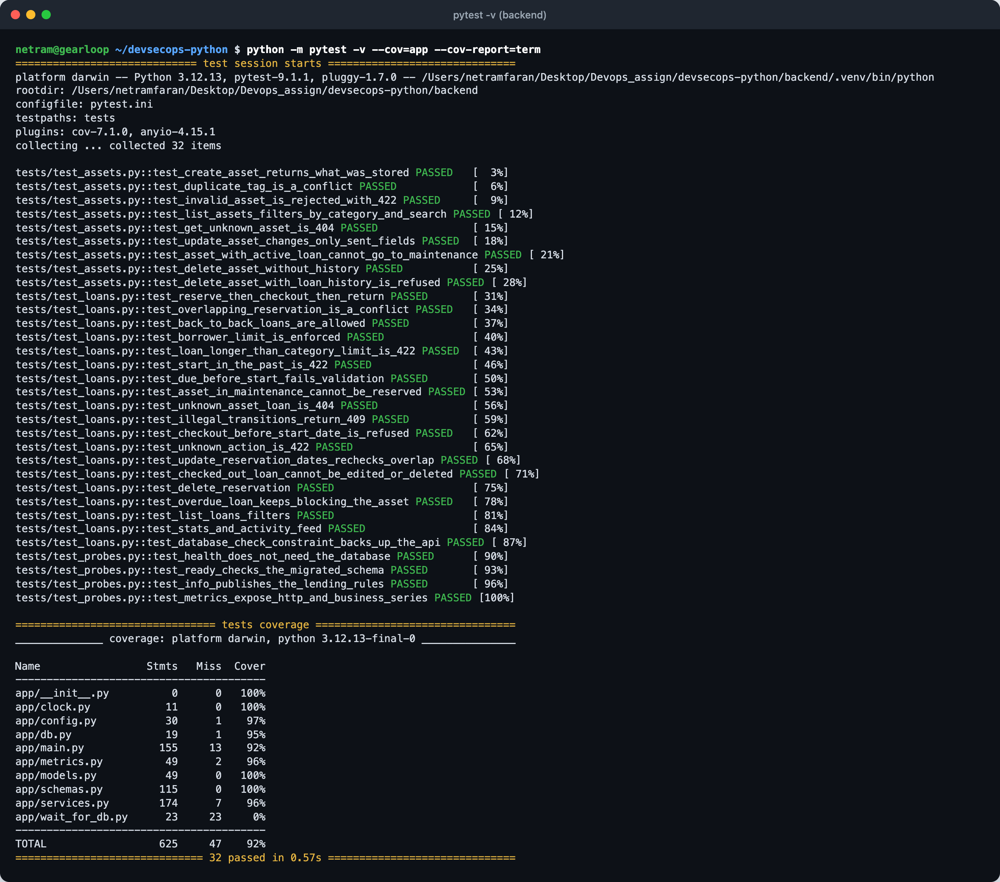

## M3 Git and GitHub

- Public fork: <https://github.com/netram75/devsecops-python>
- One commit per step, each message saying what changed and why (e.g. `security: Trivy, Gitleaks and Bandit configs; drop pip from the runtime image`).
- [`.gitignore`](.gitignore) excludes `.env`, `__pycache__/`, `node_modules/`, `.venv/`, Terraform state/plans/tfvars and `*_override.tf`. Gitleaks scans the full history on every push.

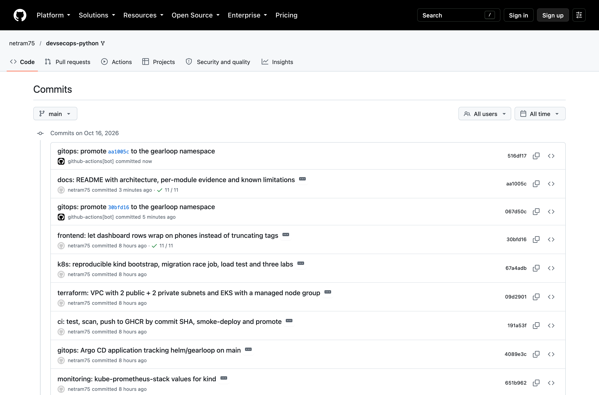

## M4 Docker

| Image | Build | Runtime user |
|---|---|---|
| [`backend/Dockerfile`](backend/Dockerfile) | **multi-stage**: dependencies installed into `/opt/venv` in a build stage; the runtime stage has no pip, setuptools or wheel (see M6 for why) | UID **10001** |
| [`frontend/Dockerfile`](frontend/Dockerfile) | **multi-stage**: `node:22-alpine` runs `npm ci && npm run build` → `nginx-unprivileged` serves `dist/` on 8080; unused nginx modules removed | UID **101** |

[`docker-compose.yml`](docker-compose.yml) starts `postgres` (healthy on `pg_isready`), then
`backend` (healthy on `/ready`, so only after migrations), then `frontend` on
`localhost:3000`. The nginx in the frontend container proxies `/api`, `/docs` and
`/openapi.json` to `${BACKEND_URL}`, rendered by envsubst at start.

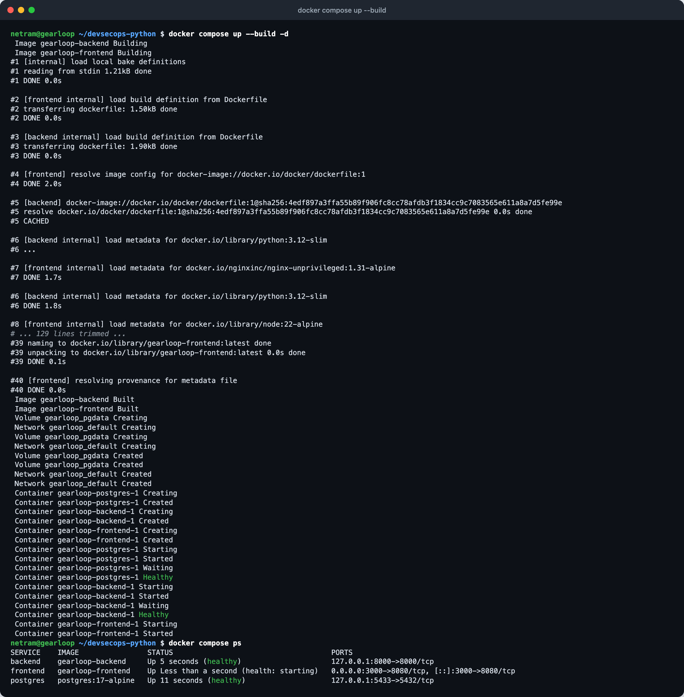
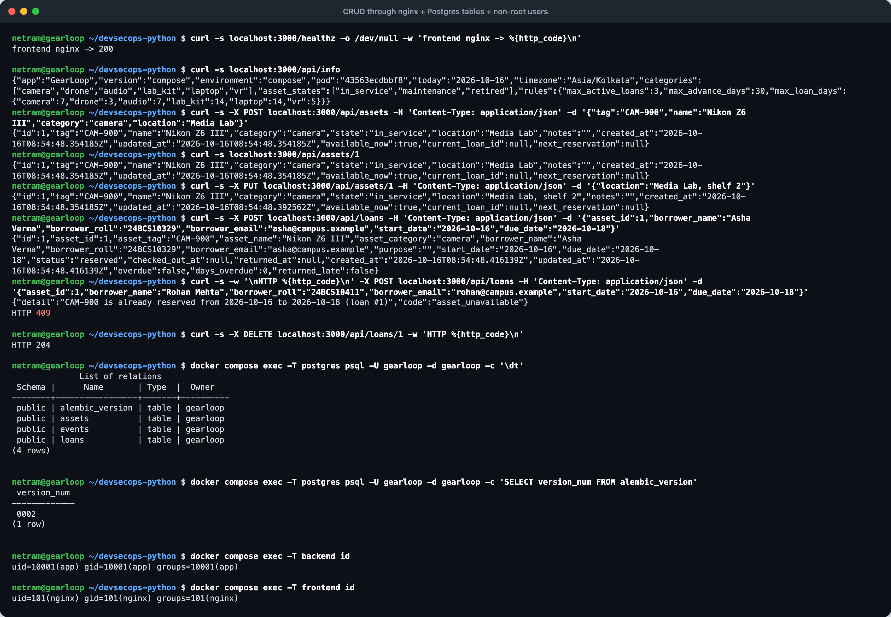

## M5 CI/CD

One workflow: [`.github/workflows/ci-cd.yml`](.github/workflows/ci-cd.yml), on every push to `main`
(and pull requests, without the push/deploy stages).

| Job | What it proves |
|---|---|
| Backend tests (pytest) | 32 tests + coverage; **fails the build** on any failure |
| Migrations on real Postgres | `upgrade → downgrade base → upgrade`, then **three `alembic upgrade head` at once**: exactly one may run migration 0001 |
| Frontend build | `npm ci`, `npm run build`, `npm audit --omit=dev --audit-level=high` |
| Secrets + SAST | Gitleaks over the full history, Bandit on `backend/app` |
| Helm lint + render | every values file renders; the chart must refuse to render without an image tag |
| Build + Trivy (matrix ×2) | `docker build` → **Trivy** → `docker save` → artifact |
| Push to GHCR (matrix ×2) | loads **the scanned tarball** (no rebuild) and pushes `ghcr.io/netram75/gearloop-{backend,frontend}:<full commit SHA>`; no `latest` tag |
| Deploy + smoke test | throwaway kind cluster, `helm upgrade --install` from GHCR, then checks `/api/info` reports this commit, a reservation gets 201, the overlapping one 409, and `/metrics` counts it |
| Promote | commits the SHA into [`gitops/values-gitops.yaml`](gitops/values-gitops.yaml) as `github-actions[bot]`; Argo CD deploys it |

Least privilege: `contents: read` by default, `packages: write` only in the push job,
`contents: write` only in promote. `paths-ignore` contains `gitops/values-gitops.yaml`, so the
promote commit does not trigger the pipeline again.

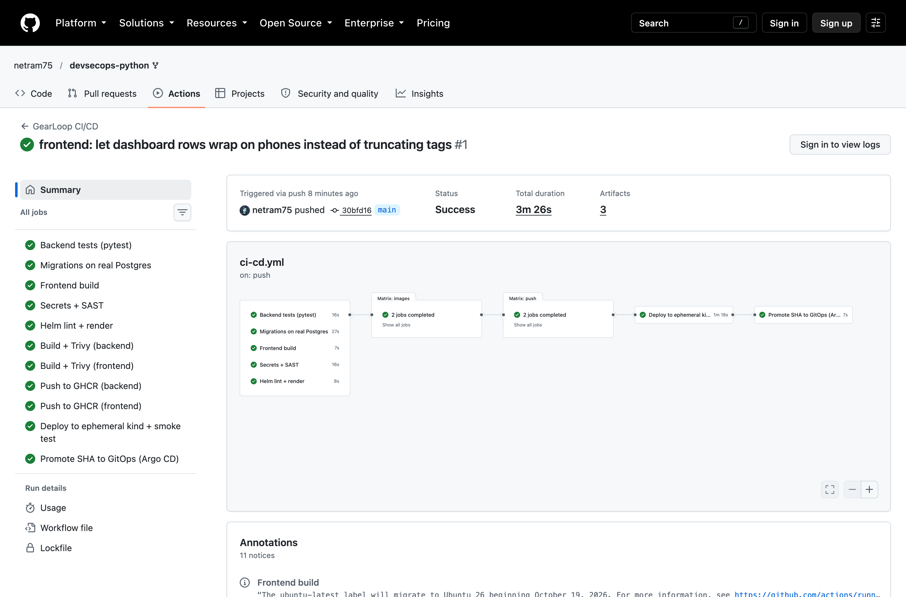
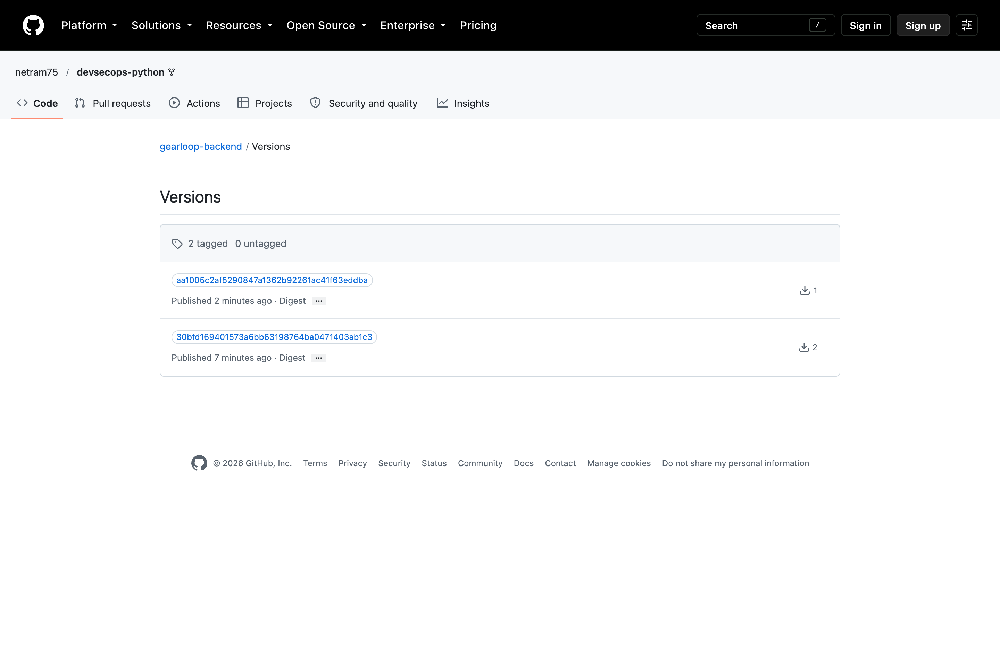


## M6 DevSecOps

[`security/trivy.yaml`](security/trivy.yaml) scans both images for vulnerabilities and
secrets, at severity HIGH and CRITICAL, with `exit-code: 1`, so the job fails and nothing
is pushed. `ignore-unfixed: true` sits under `vulnerability:`. At the top level Trivy
silently ignores it.

**What Trivy found, and what it means.** Trivy scanned the OS packages (Debian 13 / Alpine 3.24)
and every Python and npm package in both images. The first backend image **failed the gate
with 4 HIGH findings**. One of them was **CVE-2025-47273**, a path traversal in setuptools'
`PackageIndex` that lets a crafted package URL write files outside the download directory
(fixed in 78.1.1). The others were urllib3 CVE-2026-97687/97689 and msgpack
GHSA-6v7p-g79w-8964. None of them were GearLoop dependencies: all four are **vendored inside
pip itself** (`pip/_vendor/vendor.txt`). The app never runs pip, so the fix was to stop
shipping it. The backend became a multi-stage build, and the runtime image has no
pip/setuptools/wheel. Both images now scan **clean (0 HIGH/CRITICAL)**, which means no
known, fixable high-severity vulnerability in anything the containers carry. The frontend
image was clean from the start because the unused nginx modules (and with them libtiff and
libxslt) are removed in the Dockerfile.

| Gate blocking the first image (exit 1) | After the multi-stage fix (exit 0) |
|---|---|
| 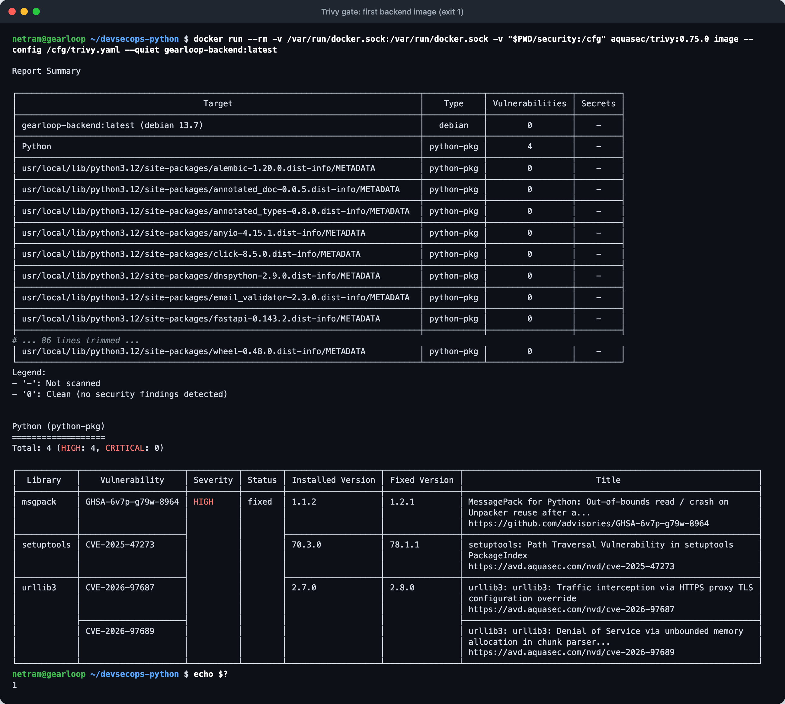 | 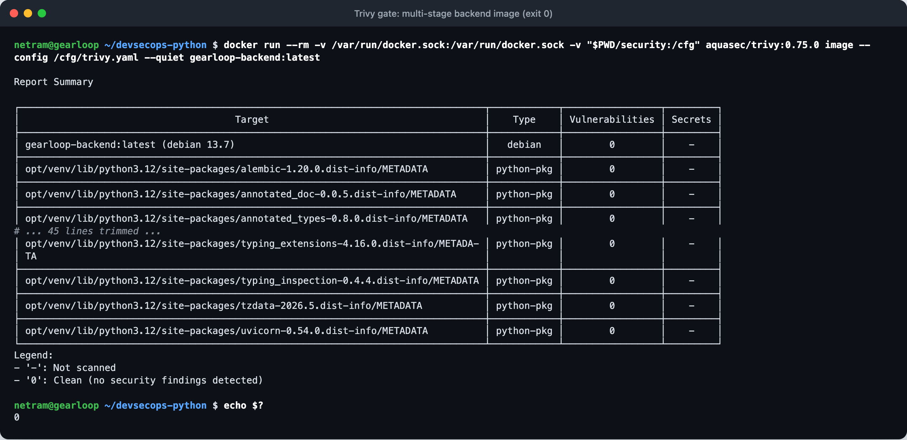 |

Trivy output from the pipeline run:

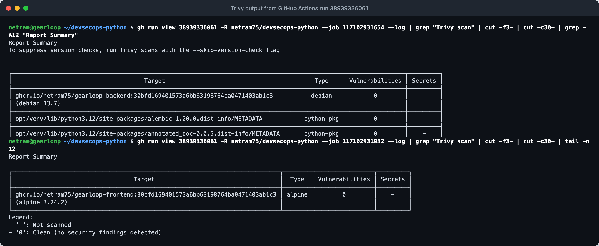

Other controls: Gitleaks on the full history (`no leaks found`), Bandit SAST, `npm audit`,
non-root images, Pod Security Admission `restricted` on the app namespaces, read-only root
filesystems, all capabilities dropped, seccomp `RuntimeDefault`, no service-account tokens
mounted, and secrets created at install time instead of committed.

## M7 Terraform

[`terraform/`](terraform/) uses plain resources, so every object is visible
([README](terraform/README.md)). The course's original HCL put whole blocks on one line and
did not parse, so it was rewritten.

- `network.tf`: VPC `10.42.0.0/16` with DNS hostnames, **2 public subnets** (ELB-tagged, public IPs) and 2 private subnets across `ap-south-1a/b`, IGW, NAT gateway + EIP, route tables.
- `iam.tf`: EKS cluster role and node role (worker, CNI, ECR read-only).
- `eks.tf`: **EKS 1.35** (public + private endpoint, API CIDR allow-list, creator admin) and a **managed node group** (2 × t3.medium in the private subnets, 1–3).
- `terraform.tfvars.example` documents every input. Credentials only come from the environment. State, plans and real tfvars are git-ignored.

> **Honest note: this ran against an emulator, not a real AWS account.** No personal AWS
> account was available for this project, so I ran the **same code** against the
> [moto](https://github.com/getmoto/moto) AWS emulator (`terraform/emulator/run.sh`). It
> injects a git-ignored `moto_override.tf` with local endpoints and fake keys. `init`, a
> 22-resource `plan`, `apply` and `destroy` all ran for real against the emulator's EC2,
> IAM and EKS APIs. Because there was no real account, there are **no AWS Console
> screenshots**. The AWS CLI output below, queried from the emulator, stands in for them.
> On a real account the same commands work with `AWS_PROFILE=...` (see the Terraform README).

| `terraform plan`: 22 to add | `terraform apply` + outputs |
|---|---|
| 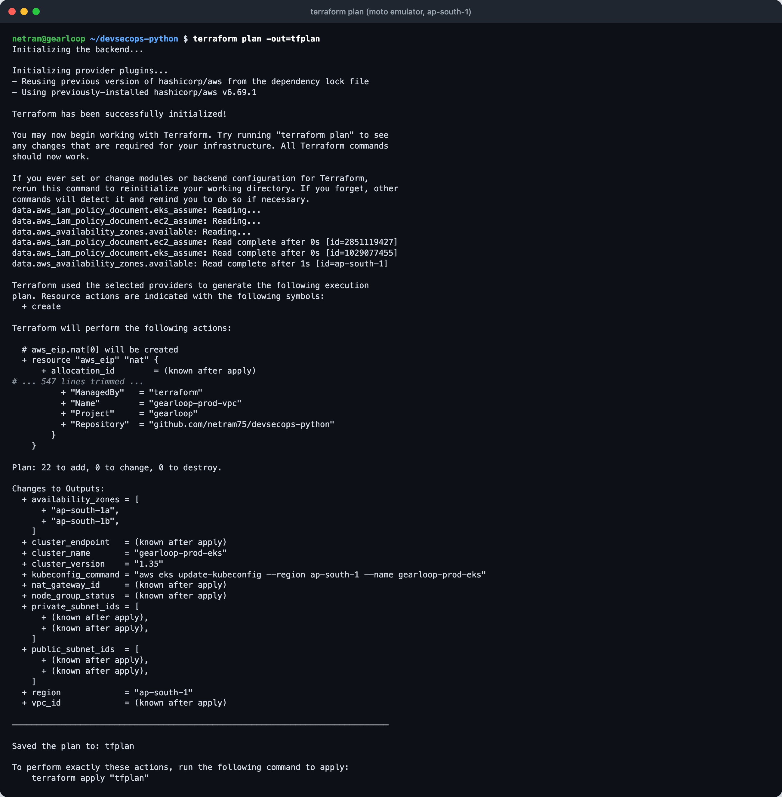 | 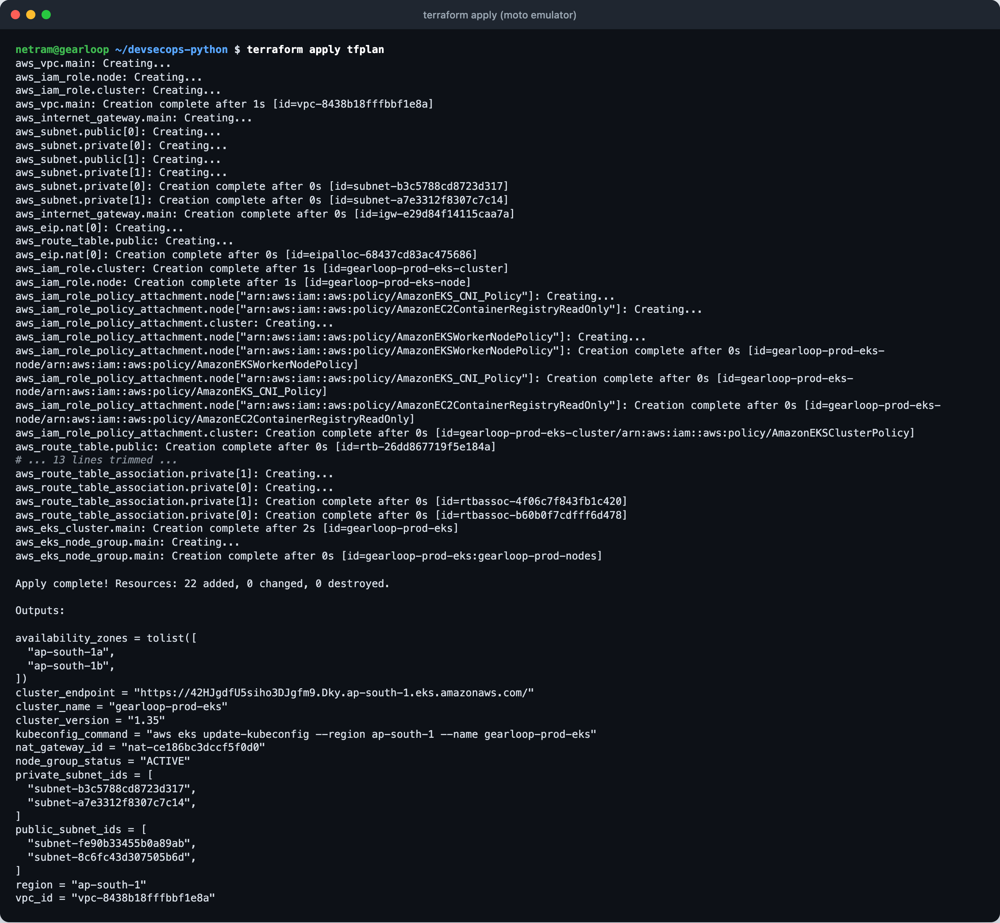 |
| **VPC, subnets, route tables, NAT, EKS, node group (AWS CLI on moto)** | **`terraform destroy`: 22 destroyed, nothing left** |
| 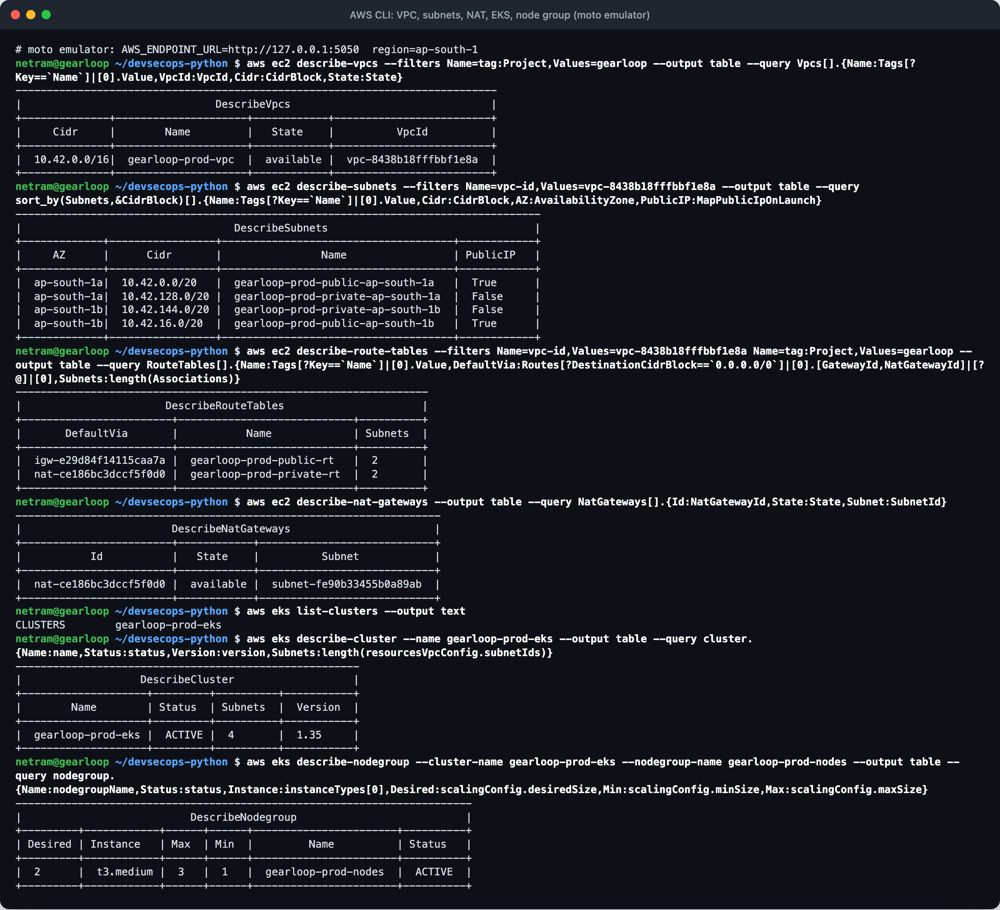 | 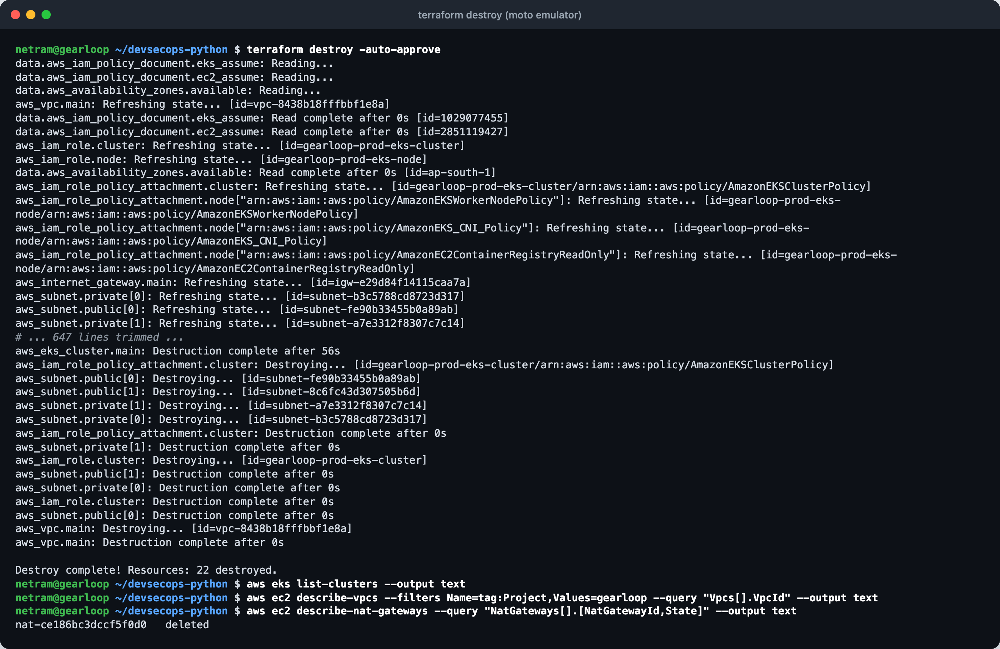 |

## M8 Kubernetes + Helm + Argo CD

**Cluster:** kind 0.33 (Kubernetes 1.37), one control plane running ingress-nginx on host
ports 80/443 and two workers, built by [`k8s/kind/bootstrap.sh`](k8s/kind/bootstrap.sh).
[`k8s/namespace.yaml`](k8s/namespace.yaml) creates `gearloop` and `gearloop-staging` with
Pod Security **restricted** enforced.

**Helm chart** [`helm/gearloop`](helm/gearloop):

| Template | Highlights |
|---|---|
| `backend.yaml` | Deployment + ClusterIP Service; `replicas` omitted when the HPA is on; startup probe `/health` (covers migrations), liveness `/health`, readiness `/ready`; `maxUnavailable: 0`; config/secret checksum annotations; spread across nodes |
| `frontend.yaml` | Deployment (2 replicas) + ClusterIP; probes on `/healthz`; `emptyDir` for `conf.d` and `/tmp` (read-only root FS) |
| `postgres.yaml` | headless Service + StatefulSet + PVC; runs as UID 70; `PGDATA` in a subdirectory |
| `ingress.yaml` | `/api`, `/docs` → backend; `/openapi.json` `ImplementationSpecific` (ingress-nginx rejects dots in `Prefix` paths); `/` → frontend |
| `hpa.yaml` · `pdb.yaml` | 2–6 backend pods at 60% CPU, 60 s scale-down window · `minAvailable: 1` per tier |
| `configmap.yaml` · `secret.yaml` | DB host/name/user in a ConfigMap; password from a Secret (`existingSecret` in staging/prod, created by the bootstrap script, never in Git) |
| `servicemonitor.yaml` · `prometheusrule.yaml` · `grafana-dashboard.yaml` | behind `monitoring.enabled` |

Guard rail: `{{ required "backend.image.tag is required (use the commit SHA)" … }}`, so nothing deploys without a SHA.

**Two environments:**
- `gearloop` (production shape, HPA 2–6) is owned by **Argo CD**
  ([`gitops/argocd-application.yaml`](gitops/argocd-application.yaml)): Helm chart from `main`
  + `values-prod.yaml` + `gitops/values-gitops.yaml`, with automated sync, prune and
  self-heal. `/spec/replicas` is ignored because the HPA owns it.
- `gearloop-staging` is installed with **`helm upgrade --install`**. Argo CD renders Helm
  itself and creates no Helm release, so this is the release that `helm list` shows.

```bash
helm upgrade --install gearloop ./helm/gearloop -n gearloop-staging -f helm/gearloop/values-staging.yaml \
  --set backend.image.tag=<sha> --set frontend.image.tag=<sha> --wait
```

| `helm upgrade --install` | pods (2+2 replicas, spread over both workers), services, ingress, `helm list` |
|---|---|
| 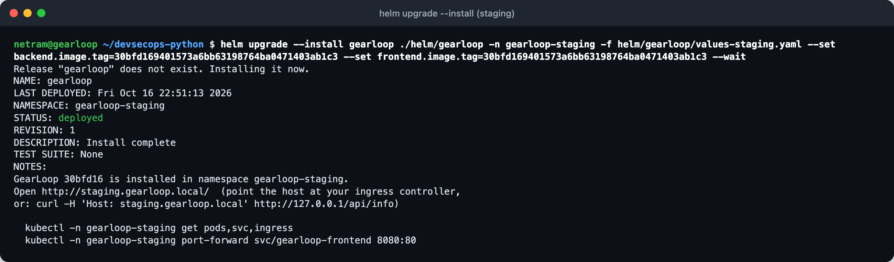 | 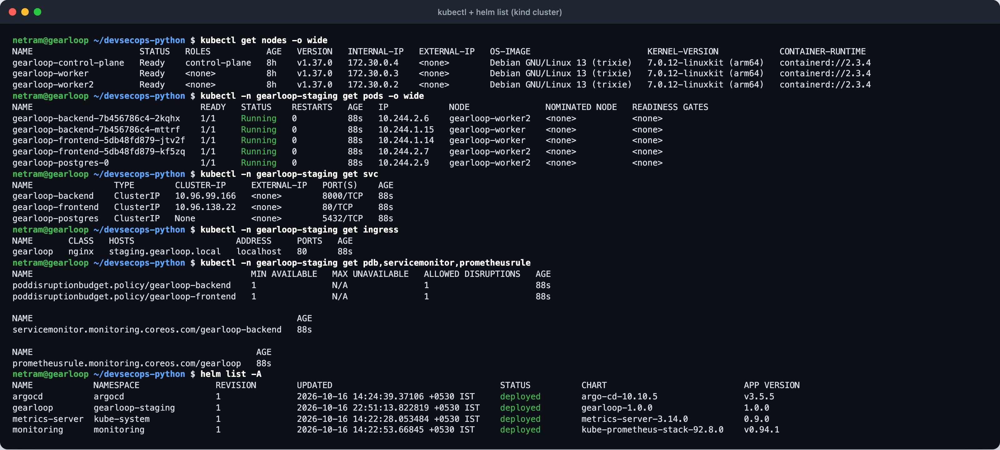 |
| **App through the Ingress hostname** | **Argo CD: Synced / Healthy at the promoted SHA** |
|  | 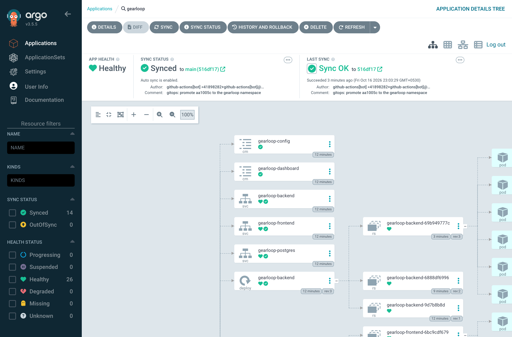 |

**GitOps loop:** push → pipeline → promote commit → Argo CD sync (60 s reconciliation) →
the UI sidebar shows the new build SHA and pod name (from `/api/info`).

**HPA under load** ([`scripts/load-test.sh`](scripts/load-test.sh)) and **migration race in the cluster**
([`k8s/jobs/migration-race.yaml`](k8s/jobs/migration-race.yaml): 3 pods run `alembic upgrade head` on an empty DB at once):

| HPA scaling | Migration race: one pod migrates, two wait on the lock |
|---|---|
| 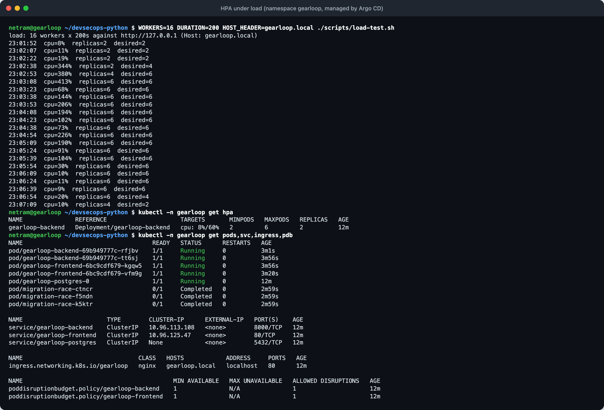 | 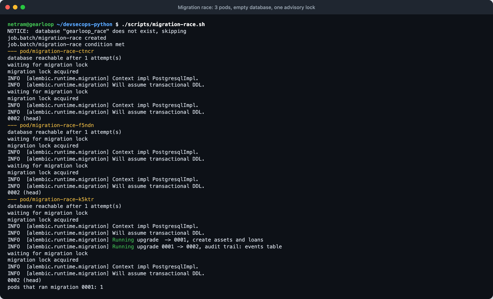 |

## M9 Observability

- **`/metrics`** via `prometheus-fastapi-instrumentator`. Latency buckets start at **5 ms**; the defaults start at 100 ms, which puts every request in the first bucket and makes p95 meaningless.
- **Business metrics**, read from the database at scrape time ([`app/metrics.py`](backend/app/metrics.py)): `gearloop_assets{state}`, `gearloop_loans{status}`, `gearloop_loans_overdue`, `gearloop_assets_available_now`, `gearloop_db_up`, `gearloop_build_info`, plus the counters `gearloop_loan_transitions_total{action}` and `gearloop_rule_rejections_total{rule}`.
- **kube-prometheus-stack** ([values](monitoring/kube-prometheus-stack-values.yaml)) with `serviceMonitorSelectorNilUsesHelmValues: false` and `ruleSelectorNilUsesHelmValues: false`. Without these, Prometheus ignores the app chart's ServiceMonitor and rules. Grafana's password comes from a Secret created at install time.
- **Alerts** ([`prometheusrule.yaml`](helm/gearloop/templates/prometheusrule.yaml)): backend down, 5xx ratio > 5%, p95 > 500 ms, DB unreachable, and the business alerts **GearLoopOverdueLoans** (≥ 3 overdue items) and **GearLoopNoGearAvailable**.
- **Grafana dashboard** shipped by the chart (ConfigMap with `grafana_dashboard: "1"`): req/s, p50/p95/p99, 5xx %, pods up, overdue, available now, requests by status class (deliberately not stacked), by endpoint, HPA replicas, CPU/memory per pod, loans by status, rule rejections, transitions.

| `/metrics` | Prometheus targets: app **UP** |
|---|---|
| 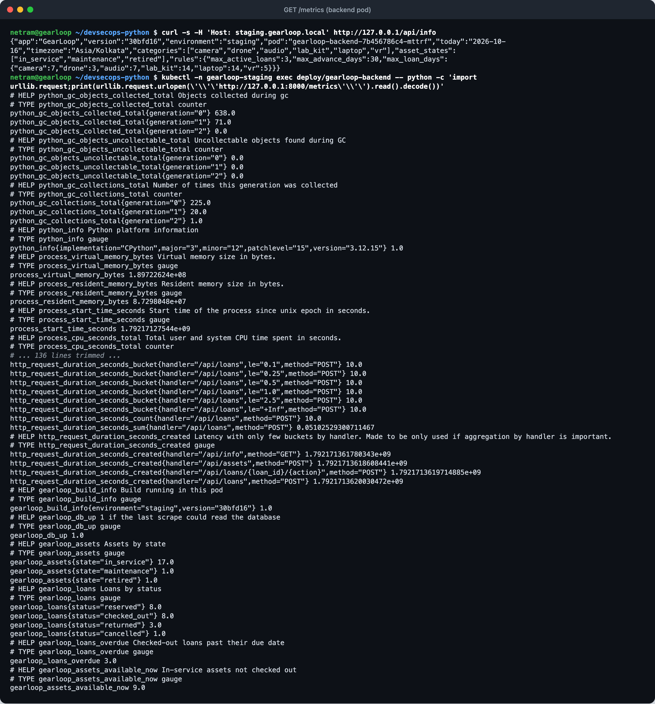 | 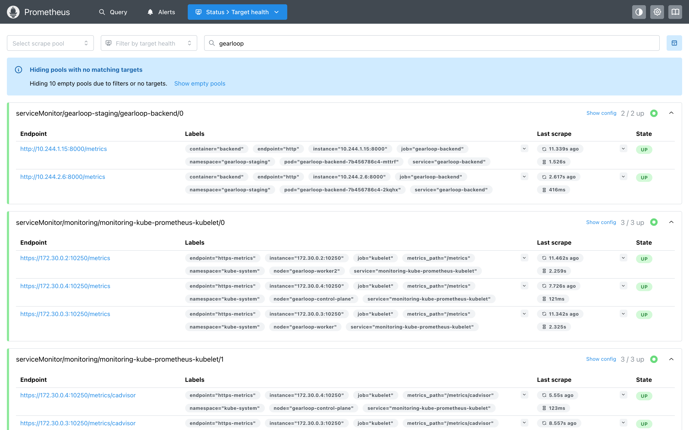 |
| **Grafana during a load test** | **Alert rules (business alert firing on 3 overdue loans)** |
| 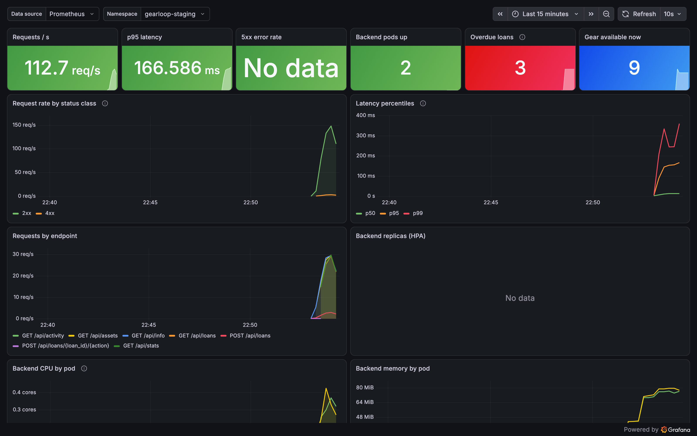 | 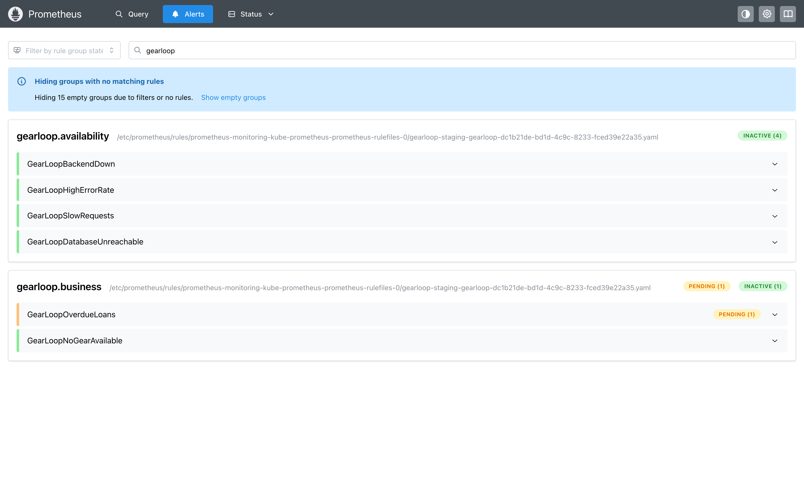 |

## Troubleshooting labs

[`troubleshooting/`](troubleshooting/README.md): three broken Deployments in `gearloop-labs`, each diagnosed and fixed with kubectl.

| Lab | Symptom | Root cause | Fix |
|---|---|---|---|
| 1 | `ImagePullBackOff` | tag typo `1.31-alpnie` | `kubectl set image` |
| 2 | pods Ready, Service answers nothing | selector `app: lab2-wbe` → no endpoints | `kubectl patch svc` |
| 3 | `Running` but `0/1` Ready | readiness probe on :80, nginx listens on :8080 | patch the probe port |

## Engineering findings

| Problem | Cause | Fix |
|---|---|---|
| Trivy failed the backend image with 4 HIGH CVEs | all four vendored inside **pip** (`pip/_vendor`), not app dependencies | multi-stage build; the runtime image ships without pip/setuptools/wheel |
| `127.0.0.1:80` reset every connection to the kind Ingress, though requests worked from inside the node | Docker Desktop forwarded the host port to the node's **IPv6** address; kind's hostPort rules are IPv4 only | nodes on an IPv4-only Docker network (`KIND_EXPERIMENTAL_DOCKER_NETWORK=kind-ipv4`) |
| `trivy image $img:latest` scanned `gearloop-backendatest` | zsh treats `:l` as the lowercase modifier | `"${img}:latest"` |
| Two replicas could both reserve the same camera | check-then-insert race | lock the asset row (`FOR UPDATE`) and a per-borrower advisory lock before checking |
| Parallel replicas racing on `alembic upgrade` | each pod migrates on start | `pg_advisory_lock` in `alembic/env.py`; proven in CI and with a 3-pod Job |
| `alembic` could not import `app` in the container | console scripts do not add the CWD to `sys.path` | `prepend_sys_path = .` |
| p95 latency was always "100 ms" | default histogram buckets start at 100 ms | buckets from 5 ms |
| Prometheus ignored the app's ServiceMonitor | kube-prometheus-stack selects only its own release by default | the two `…SelectorNilUsesHelmValues: false` settings |
| `helm list` was empty for production | Argo CD renders Helm itself, no release object | a Helm-installed staging namespace |
| The pipeline would retrigger itself | promote commits to `main` | `paths-ignore: gitops/values-gitops.yaml` |
| An overdue camera looked "free" again after its due date | overlap only compared dates | a checked-out loan blocks until it is actually returned (`blocking_end`) |
| `returned_late` was wrong near midnight | UTC timestamp vs campus-local due date | compare in `Asia/Kolkata` (`clock.local_date`) |
| `terraform plan` on moto wanted to replace the node group after apply | moto invents an SSH `remote_access` block and version 1.19 | documented emulator artifact; the code sets neither |
| 5xx panel showed "No data" with zero errors | `rate()` of a series that never existed is empty | `or vector(0)` |

## Known issues and limitations

- **Terraform ran against the moto emulator, not real AWS** (see M7). There are no AWS Console screenshots, no real EKS nodes and no `kubectl get nodes` on EKS. Running `terraform/` with a personal `AWS_PROFILE` is the remaining step (about 15 min and $0.50, then destroy).
- The application runs on **kind** on a laptop, not on the EKS cluster.
- **ingress-nginx was retired upstream in March 2026.** 1.15.1 is its final release. It is fine for this demo; production would move to the Gateway API or another maintained controller.
- PostgreSQL is a single StatefulSet pod with no backups or replication. Production would use RDS or an operator such as CloudNativePG.
- No authentication: anyone who can reach the UI can lend gear. A real deployment would put SSO (campus Google/Microsoft) in front and record who acted in the audit trail.
- Business gauges are read per pod from the shared DB, so dashboards aggregate them with `max()`, not `sum()`.
- Demo history and overdue items come from `scripts/age-demo-data.sql`, which backdates seeded loans, because the API correctly refuses loans that start in the past.
- GHCR images are public, so the cluster pulls without a secret. The CI deploy job still uses an image pull secret, so it would work with private images too.

## M10 Presentation

[`demo/`](demo/):
- `GearLoop-demo.mp4`: walkthrough in the order SUBMISSION.md asks for (slides → codebase → CI/CD push and run → Terraform → Argo CD → Kubernetes → Prometheus → Grafana), with on-screen captions and no voice-over.
- `GearLoop-presentation.pptx` / `.pdf`: overview, tech stack, architecture, CI/CD, DevSecOps, infrastructure, Kubernetes + GitOps, observability, learnings, limitations.

## Submission checklist

| Rubric item | Evidence |
|---|---|
| Public repo, ≥ 10 meaningful commits, `.gitignore` | [M3](#m3-git-and-github) |
| `/health`, ≥ 4 REST endpoints, Postgres + Alembic, React UI, responsive | [M1](#m1-application) |
| pytest passes, ≥ 5 tests on ≥ 3 endpoints, test DB, `pytest.ini`/`conftest.py` | [M2](#m2-testing) |
| backend Dockerfile, multi-stage frontend, non-root, compose starts 3 services | [M4](#m4-docker) |
| workflow on push to main, pytest gate, frontend build, both images, GHCR, SHA tags | [M5](#m5-cicd) |
| Trivy on both images, fails on HIGH/CRITICAL, CVE explained | [M6](#m6-devsecops) |
| valid HCL, init, plan, VPC + 2 public subnets, EKS + node group, destroy, tfvars example | [M7](#m7-terraform) (emulator, see note) |
| namespace.yaml, Helm chart, `helm upgrade --install`, ≥ 2 replicas, ClusterIP, Ingress `/` and `/api`, pods Running | [M8](#m8-kubernetes--helm--argo-cd) |
| `/metrics`, Prometheus scraping (UP), Grafana, live panel | [M9](#m9-observability) |
| README, video, slides | this file, [demo/](demo/) |
